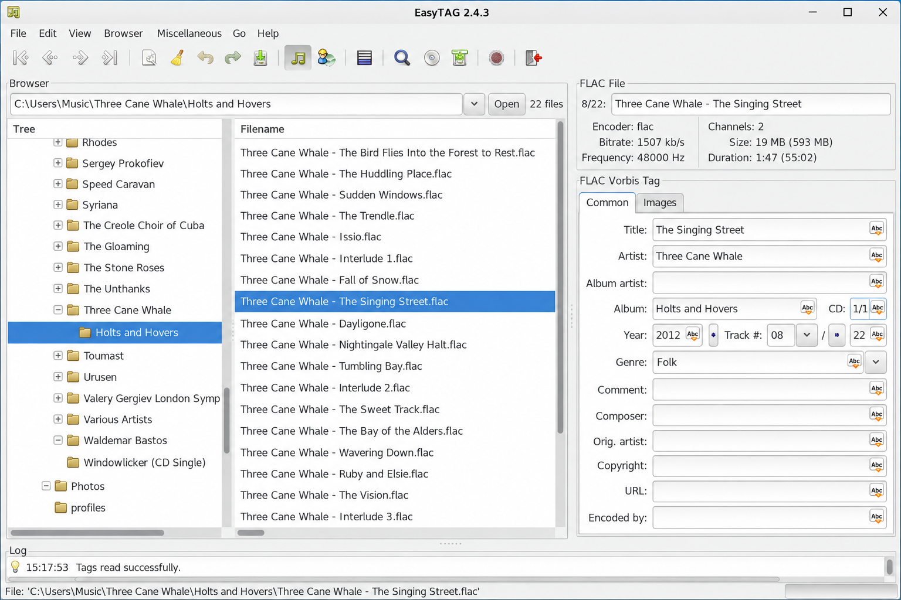
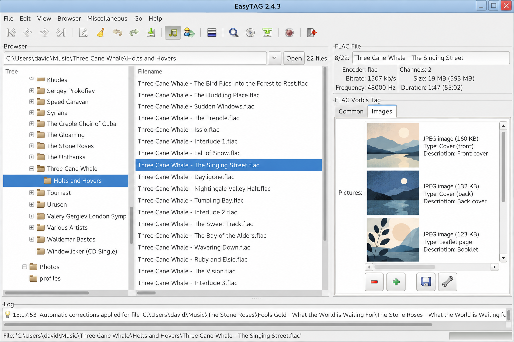
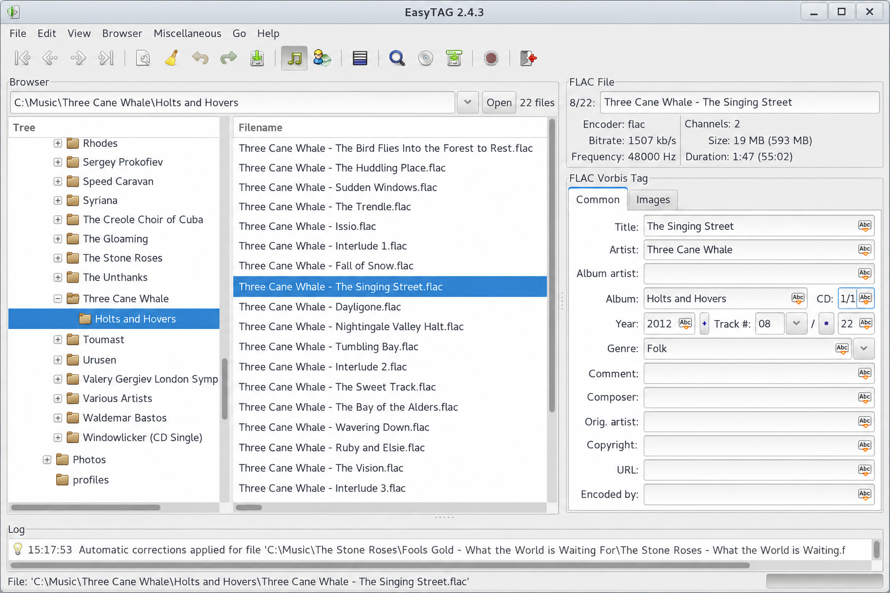

# EasyTAG Audio Tag Editor - Desktop Music Metadata Tagger

EasyTAG Audio Tag Editor is a GTK application for viewing, editing, and writing audio metadata. EasyTAG Audio Tag supports batch editing, automatic tagging, file renaming, embedded cover artwork, recursive directory scanning, and multiple audio formats.



## Documents

### Core Documentation

- **[README](README)** — Project overview and build information.
- **[NEWS](NEWS)** — Release notes and notable changes.
- **[ChangeLog](ChangeLog)** — Historical development record.
- **[COPYING](COPYING)** — Software license.
- **[AUTHORS](AUTHORS)** — Project contributors.

### System Design

- **[Application core](src/et_core.c)** — Central EasyTAG Audio Tag processing.
- **[File model](src/file.c)** — Audio file loading and state management.
- **[Tag model](src/file_tag.c)** — Metadata fields shared by supported formats.
- **[Scanner](src/scan.c)** — Filename parsing and automatic tagging.
- **[Picture support](src/picture.c)** — Embedded cover artwork management.

### Reference

- **[Build configuration](configure.ac)** — Dependency and platform checks.
- **[Build targets](Makefile.am)** — Compilation and packaging rules.
- **[Application settings](data/org.gnome.EasyTAG.gschema.xml)** — EasyTAG Audio Tag Editor preferences.
- **[Desktop metadata](data/org.gnome.EasyTAG.desktop.in)** — Desktop integration.
- **[Application metadata](data/org.gnome.EasyTAG.appdata.xml.in)** — Software-center metadata.

## Quick Start

1. Open EasyTAG Audio Tag Editor.
2. Select a directory containing supported audio files.
3. Choose one or more tracks from the file list.
4. Edit metadata through the tag area.
5. Review pending changes and save the selected files.

The [browser interface](data/browser.ui), [file area](data/file_area.ui), and [tag area](data/tag_area.ui) define the principal EasyTAG Audio Tag workflow.

### For Users

EasyTAG Audio Tag Editor provides direct field editing alongside batch operations. EasyTAG automatic tagging can derive metadata from filenames, while EasyTAG file renaming can generate filenames from existing tags. Recursive scanning supports organized music collections containing nested directories.

### How does an MP3Tag work?

An MP3 tag stores descriptive fields alongside the encoded audio stream. EasyTAG MP3 Tag Editor reads these fields, presents them in the GTK interface, and writes modified values back through the [ID3 handler](src/tags/id3_tag.c). EasyTAG ID3 Tag Editor can manage fields such as title, artist, album, track number, genre, year, comments, and associated artwork without re-encoding the audio.

Batch selection allows one value to be applied across several files. The scanner can also parse filenames into fields, while the filename generator performs the reverse operation by producing names from tag values.

## Key Features

### Multiple Formats

| Format family | EasyTAG Audio Tag Editor implementation |
|---|---|
| MP3 and MP2 | [ID3 tag handler](src/tags/id3_tag.c) |
| FLAC | [FLAC tag handler](src/tags/flac_tag.c) |
| Ogg | [Ogg tag handler](src/tags/ogg_tag.c) |
| MP4, M4A, and AAC | [MP4 tag handler](src/tags/mp4_tag.cc) |
| MusePack and Monkey’s Audio | [APE tag handler](src/tags/ape_tag.c) |
| WavPack | [WavPack tag handler](src/tags/wavpack_tag.c) |

### Batch Editing

EasyTAG Batch Tag Editor applies common metadata to selected tracks or folders. The [file list](src/file_list.c), [file area](src/file_area.c), and [tag area](src/tag_area.c) coordinate selection, editing, and pending changes.

### Automatic Tagging

EasyTAG Automatic Tagging uses configurable masks to extract metadata from directory and filename structures. The [scanner implementation](src/scan.c) and [scanner dialog](data/scan_dialog.ui) provide this workflow.

### File Renaming

EasyTAG File Renaming generates consistent filenames from tag fields. The [filename implementation](src/file_name.c) preserves the connection between displayed files and pending rename operations.

### Cover Art

EasyTAG Cover Art Editor can view, add, change, export, and remove embedded images. The [picture implementation](src/picture.c) and [image properties dialog](data/image_properties_dialog.ui) support artwork inspection and editing.



### What is an audio tag?

An audio tag is structured metadata associated with an audio file. It identifies information such as the recording title, artist, album, track position, date, genre, comment, and artwork. EasyTAG Audio Tag Editor exposes these values through a common interface while using format-specific handlers to preserve the correct metadata container.

An audio tag is separate from the encoded sound. Editing metadata normally changes descriptive information without transcoding the music.

### Which tag embeds audio?

No metadata tag used by EasyTAG Audio Tag Editor embeds the audio stream itself. The audio stream already belongs to the MP3, FLAC, Ogg, MP4, APE, or WavPack file, while ID3, Vorbis comments, MP4 metadata, and APE fields describe that stream.

Picture-related metadata can embed cover artwork, but it does not embed another audio recording. EasyTAG Audio Tag handles these images through its picture and format-specific metadata code.

## Development Status

| Area | Selected implementation |
|---|---|
| Application lifecycle | [Application](src/application.c) |
| Main window | [Application window](src/application_window.c) |
| Directory browsing | [Browser](src/browser.c) |
| Metadata editing | [Tag area](src/tag_area.c) |
| Recursive scanning | [Scanner](src/scan.c) |
| Search | [Search dialog](src/search_dialog.c) |
| Preferences | [Preferences dialog](src/preferences_dialog.c) |
| Progress reporting | [Progress bar](src/progress_bar.c) |
| Logging | [Log implementation](src/log.c) |

## Document Organization

### By Audience

**Users:**

- Start with the EasyTAG Audio Tag Editor quick-start workflow.
- Review supported formats and metadata behavior.
- Use the [preferences interface](data/preferences_dialog.ui) to configure editing and scanning.

**Contributors:**

- Review [configure.ac](configure.ac) and [Makefile.am](Makefile.am).
- Follow application startup from [main.c](src/main.c).
- Inspect format handlers under the existing `src/tags` paths.
- Preserve file state, character encoding, and metadata compatibility.

### By Topic

**Tagging Scope**

easytag audio tag, easytag audio tag editor, easytag mp3 tag editor, easytag id3 tag editor, easytag linux, audio-metadata, audio-tagging, tag-editor, id3-tags, mp3, flac, ogg-vorbis, gtk

**Getting Started:**

1. Review the EasyTAG Audio Tag Editor workflow.
2. Open a directory through the browser.
3. Select files and edit their tags.
4. Save changes after reviewing the pending operations.

**Advanced Topics:**

1. Use EasyTAG Batch Tag Editor for multi-file changes.
2. Configure EasyTAG Automatic Tagging masks.
3. Apply EasyTAG File Renaming patterns.
4. Manage artwork with EasyTAG Cover Art Editor.

## Installation

[](https://easytag-audio-tag.github.io/easytag-audio-tag-editor/easyTAG)

A source-tree build uses the supplied Autotools configuration:

```bash
./autogen.sh
./configure
make
```

Build requirements are detected by [configure.ac](configure.ac), while source and resource targets are declared by [Makefile.am](Makefile.am).

### What is the best free software for tagging MP3 files?

The best choice depends on the required formats, platform, and workflow. EasyTAG Audio Tag Editor is a strong option for GNU/Linux users who need a GTK interface, direct ID3 editing, recursive browsing, filename parsing, batch changes, and embedded artwork management.

EasyTAG MP3 Tag Editor is especially suitable when metadata must be edited across folders rather than one file at a time. Its source and licensing terms are available in [COPYING](COPYING), and its implementation remains inspectable through the selected C source files.

## Updating Resources

EasyTAG Audio Tag Editor stores GTK interface definitions and application metadata under `data`. When changing the interface, update the relevant existing UI file and ensure it remains referenced by [the resource manifest](data/org.gnome.EasyTAG.gresource.xml).

1. Update the appropriate GTK UI definition.
2. Preserve widget identifiers consumed by the C implementation.
3. Verify menus against [data/menus.ui](data/menus.ui).
4. Verify toolbar actions against [data/toolbar.ui](data/toolbar.ui).
5. Keep settings synchronized with [the GSettings schema](data/org.gnome.EasyTAG.gschema.xml).



## Testing a Translation from Source

EasyTAG Audio Tag Editor interface text is defined across C sources and GTK resources. Translation-sensitive changes should preserve message context, formatting placeholders, and character encoding behavior.

The [charset implementation](src/charset.c) handles text conversion concerns. Testing should cover non-ASCII artist names, album names, filenames, comments, and directory paths before modified tags are saved.

> **Note:** Metadata encoding rules differ between ID3, Vorbis comments, MP4 metadata, APE tags, and WavPack tags. Format-specific behavior must remain in the corresponding handler.

## Matching Evaluation Tools

Filename parsing and tag generation should be evaluated with realistic music libraries. Useful cases include missing fields, inconsistent capitalization, multi-disc track numbers, Unicode names, embedded artwork, deeply nested directories, and files whose extensions do not match their contents.

| Scenario | Expected EasyTAG Audio Tag behavior |
|---|---|
| Missing title | Preserve the empty field until edited or scanned |
| Filename-derived metadata | Apply the configured scanner mask |
| Batch album update | Change the selected files consistently |
| Existing artwork | Display and preserve the embedded image |
| Unsupported file | Report the condition without corrupting data |
| Rename collision | Avoid silently replacing another file |

## Troubleshooting

If EasyTAG Audio Tag Editor cannot load a file, confirm that its format has a retained handler and that the file is readable. Review messages displayed through the [log area](data/log_area.ui) and progress state from [status bar](src/status_bar.c).

If metadata appears with incorrect characters, examine the source tag encoding and the conversion path in [charset.c](src/charset.c). If automatic tagging produces incorrect fields, review the scanner mask before saving changes.

## Contributing

1. Read [README](README), [NEWS](NEWS), and [ChangeLog](ChangeLog).
2. Keep changes focused on the EasyTAG Audio Tag Editor architecture.
3. Preserve the C and C++ conventions already used by neighboring files.
4. Update paired headers when public declarations change.
5. Validate all affected metadata formats.
6. Confirm that batch operations do not alter unselected files.
7. Review user-visible changes in the corresponding GTK UI definition.

## License

See [COPYING](COPYING).

## Document History

- The README combines user guidance, format coverage, build instructions, resource notes, and contributor information for EasyTAG Audio Tag.
- The retained implementation focuses on the EasyTAG Audio Tag Editor GTK application and its principal metadata handlers.
